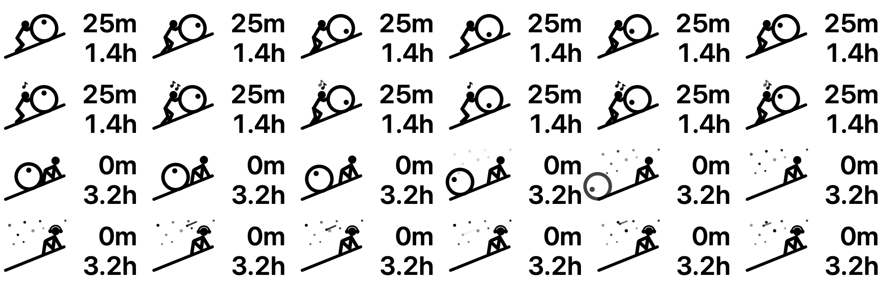

# aw-timer

[English](README.md)

一個類似 Rize 的 macOS 自動專注計時器，以 [ActivityWatch](https://activitywatch.net/) 為資料來源。
它住在選單列，是一個小小的薛西弗斯動畫：你工作時他推石頭上山，你休息時他坐在星空下休息。

所有紀錄都留在你的 Mac 上，不需要帳號，也不會上傳到雲端。



*由上到下：工作中、工作＋音樂（他會唱歌）、開始休息（石頭滾走）、休息＋音樂（戴耳機、星空與流星）。*

## 功能

- **自動追蹤**：讀取 ActivityWatch 的視窗與離開紀錄，依你可以修改的規則，把每個 App 或網頁分成專注、中性、分心三類。
- **選單列計時**：上排是本次連續專注的分鐘數，下排是今日專注時數，例如 `25m / 3.2h`。動畫由 Core Animation 播放，幾乎不吃 CPU。
- **專注時段**：累積專注 ≥ 25 分鐘、中間中斷不到 5 分鐘，就算一個專注時段。
- **通知**：
  - 距上次休息滿 50 分鐘提醒休息（用電腦的時間都算，不只專注）；
  - 連續分心 10 分鐘提醒你回到正軌；
  - 進入專注時段時通知鼓勵。
- **強制休息**：可選 5、10、15、30 分鐘，或不限時、手動結束。
- **專注目標**：自己打字設定，會顯示在選單、通知和報表裡。
- **專案**：依視窗標題規則、[Claude Code](https://claude.com/claude-code) session 的工作資料夾，或選單手動選擇，把時間歸到專案。
- **每日報表**：在終端機執行 `aw-timer report -i`，看完報表還能直接手動調整分類。
- **背景音**：按右鍵播放或暫停。
  - 免費網路電台：Lofi、Jazz、Lounge、97.7 古典音樂台（好家庭）。
  - 程式自己合成的雨聲、咖啡廳聲，以及白、粉紅、棕噪音和雙耳節拍。
  - 可控制 Spotify 和 [Feishin](https://github.com/jeffvli/feishin)，切換到別的背景音時它們會自動暫停。
  - 音量完全跟隨系統音量，程式不會更動。

## 系統需求

| | |
|---|---|
| macOS | **11 Big Sur 以上**，支援 Apple Silicon 和 Intel（universal 執行檔）。編譯的最低目標版本是 macOS 11.0，但只在 macOS 27（Apple Silicon）上實際測試過。 |
| [ActivityWatch](https://activitywatch.net/) | 必要。測試版本為 v0.14.1。請允許它要求的權限，才能讀到視窗標題。 |
| Spotify／Feishin | 選用。Feishin 要在它的設定裡開啟「遠端控制伺服器」，並把密碼填進 `config.toml`。 |
| 從原始碼編譯 | 需要 [Rust](https://rustup.rs) 1.88 以上，以及 Xcode Command Line Tools（`xcode-select --install`）。 |

## 安裝

1. 安裝並啟動 ActivityWatch：

   ```bash
   brew install --cask activitywatch
   ```

   ```bash
   open -a ActivityWatch
   ```

2. 用 **Homebrew** 安裝 aw-timer（從原始碼編譯，需要時 Homebrew 會自動安裝 Rust）：

   ```bash
   brew tap samuel20040521/tap && brew trust samuel20040521/tap
   ```

   ```bash
   brew install aw-timer && brew services start aw-timer
   ```

   `brew services` 會立刻啟動 aw-timer，並在每次登入時自動啟動。更新用 `brew upgrade aw-timer`；移除用 `brew services stop aw-timer && brew uninstall aw-timer`。

   **或者**下載編譯好的版本並執行安裝程式：

   ```bash
   curl -L -o aw-timer.tar.gz https://github.com/Samuel20040521/aw-timer/releases/latest/download/aw-timer-macos-universal.tar.gz
   ```

   ```bash
   tar xzf aw-timer.tar.gz && cd aw-timer-macos-universal && ./install.sh
   ```

   安裝程式會：
   - 把執行檔放到 `~/Library/Application Support/aw-timer/`；
   - 建立 `~/.local/bin/aw-timer` 指令；
   - 在 `~/.config/aw-timer/config.toml` 建立設定檔，已經有的話不會覆蓋；
   - 註冊 LaunchAgent，登入時自動啟動。

> **關於 Gatekeeper**：這個執行檔沒有 Apple 開發者簽章。用上面的 `curl` 下載可以正常執行；如果是用瀏覽器下載，macOS 會擋住。你可以看過原始碼後自己編譯，或自行決定是否移除隔離標記：`xattr -dr com.apple.quarantine aw-timer-macos-universal`。

### 從原始碼安裝

```bash
git clone https://github.com/Samuel20040521/aw-timer.git
```

```bash
cd aw-timer && ./install.sh
```

## 使用

| 操作 | 作用 |
|---|---|
| 左鍵點圖示 | 打開選單：休息、目標、專案、背景音、報表 |
| 右鍵（或 Control＋點） | 播放或暫停背景音 |
| `aw-timer status` | 目前狀態 |
| `aw-timer report [-1 \| YYYY-MM-DD] [-i]` | 每日報表；`-i` 可以把項目手動分類成專注、娛樂或中性 |
| `aw-timer restart` | 改完設定後重新載入 |

設定檔在 `~/.config/aw-timer/config.toml`，包括各種門檻、分類規則、專案和背景音網址。所有選項的說明都在 [`default_config.toml`](default_config.toml)。

## 隱私

- 全部在本機執行，資料來源是 ActivityWatch 在本機的 API（`localhost:5600`）。
- 為了判斷你在哪個 Claude Code session，aw-timer 只讀 `~/.claude/projects/` 紀錄裡的時間、工作資料夾、session 代號和 session 標題這幾個欄位，不會儲存或傳送任何對話內容。
- 只有在播放網路電台時才會連上網路。

## 移除

```bash
./uninstall.sh
```

這會移除 LaunchAgent 和執行檔，`~/.config/aw-timer/` 裡的設定檔會保留。

## 致謝

- [ActivityWatch](https://activitywatch.net/) 提供追蹤資料。
- [Symphonia](https://github.com/pdeljanov/Symphonia) 負責音訊解碼，[rodio](https://github.com/RustAudio/rodio) 負責播放。
- [objc2](https://github.com/madsmtm/objc2) 提供 AppKit、Core Animation、CoreGraphics 的 Rust 介面。
- 電台網址來自社群維護的 [Radio Browser](https://www.radio-browser.info/)，電台內容的版權屬於各電台。

## 授權

[MIT](LICENSE)
